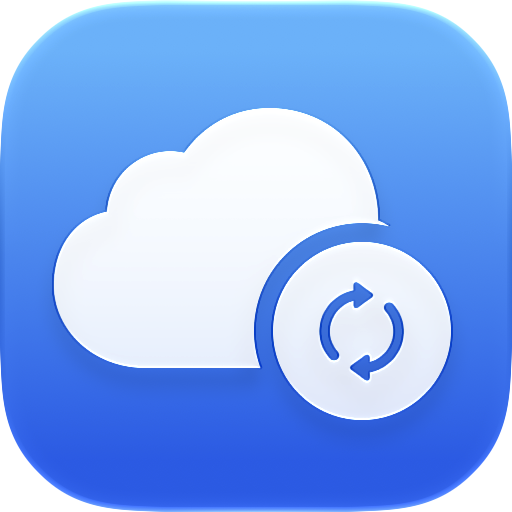

<div align="center">



# SyncBar

**One menu bar icon for every cloud sync account on your Mac.**

OneDrive, Dropbox and Nextcloud each want a menu bar icon of their own.
SyncBar folds them into one, shows how every account is doing, and opens
each app's own panel when you need it.

[](https://github.com/AlexMorrissey-Smith/SyncBar/releases/latest)


[](LICENSE)

</div>

---

## What it does

- **One icon, every account.** A cloud in the menu bar that tells you at a
  glance whether everything is up to date. A badge spins while anything
  syncs, and turns into a warning or error badge when an account needs you.
- **Status per account.** The popover lists each account with its state:
  Up to date, Syncing (with progress), Paused, Error, Needs sign-in or App
  not running. Two OneDrive accounts show up as two rows.
- **The apps' own panels, one click away.** Click a row and that app opens
  its usual menu or panel, right under SyncBar's icon.
- **A tidy menu bar.** SyncBar can switch off the sync apps' own icons
  using macOS's built-in Menu Bar settings, and switches them back on when
  it quits.
- **Fixes itself.** If a sync app started without its menu bar item (for
  example after a forced restart), SyncBar relaunches it so status and
  panels keep working.
- **Private.** Everything is read on your Mac. SyncBar makes no network
  connections.

Works with **OneDrive** (personal and business, several accounts),
**Dropbox** and **Nextcloud** (File Provider and classic folder sync).
Other File Provider apps, such as Google Drive, are found too and can be
shown from Settings.

## Install

1. Download `SyncBar-<version>.zip` from the
   [latest release](https://github.com/AlexMorrissey-Smith/SyncBar/releases/latest)
   and unzip it.
2. Move **SyncBar.app** to your Applications folder and open it. It is
   signed with a Developer ID and notarised by Apple, so it opens without
   warnings.
3. Follow the setup window to grant the two permissions below. It closes
   by itself once both are granted.

To start SyncBar when you log in, turn on **Launch at login** in its
Settings.

### Permissions

| Permission | Why SyncBar needs it |
| --- | --- |
| **Accessibility** | To read each sync app's menu bar status and to open its panel. |
| **Full Disk Access** | To switch the sync apps' own menu bar icons off and on. macOS keeps those switches in a protected folder. Only needed if *Hide the apps' own menu bar icons* is on. |

## Requirements

- macOS 27.2 or later (built and tested on 27.3)
- At least one of OneDrive, Dropbox or Nextcloud

## How it works

<details>
<summary><b>Finding accounts</b></summary>

Each folder in `~/Library/CloudStorage` carries the extended attribute
`com.apple.file-provider-domain-id` (`<providerID>/<domainID>`), which maps
it to its app. Nextcloud in classic folder-sync mode is read from
`~/Library/Preferences/Nextcloud/nextcloud.cfg`. OneDrive runs one process
per account; SyncBar tells them apart by the
`settings/LockInstance_<Business1|Business2|Personal>` lock file each
process holds open.

</details>

<details>
<summary><b>Reading status</b></summary>

Two sources are combined:

1. Every few seconds, the text of each app's menu bar item (title,
   description, help, value), read through the Accessibility API. On
   macOS 27 third-party status items are hosted in
   `com.apple.MenuBarAgent`'s accessibility tree; SyncBar walks it and
   matches items to apps with `AXUIElementGetPid`. Each app's
   `AXExtrasMenuBar` is used too, and still answers while the icon is
   switched off.
2. `fileproviderctl dump <provider>/<domain>` for byte progress, sign-in
   and error state. Dumps run one at a time, at most once a minute per
   account, while an account is syncing or its menu bar text gives no
   state, plus once at launch. SyncBar stops reading as soon as the header
   is parsed, with a 45-second timeout.

</details>

<details>
<summary><b>Opening an app's panel</b></summary>

SyncBar presses the app's own menu bar item through Accessibility, which
makes the app open its menu or panel. Success is judged by a new window
from that app, because apps that show a classic menu block the press
reply. When an app's icon is switched off, its panel can open at a parked
position off screen; SyncBar moves it under its own icon and checks that
it stays there.

</details>

<details>
<summary><b>Hiding the apps' icons</b></summary>

macOS 27 puts icons that don't fit into the system overflow instead of
pushing them off screen, so SyncBar uses the system's own per-app switch,
the same one as System Settings › Menu Bar › Menu Bar Controls. It lives
in Control Center's group container preferences (`trackedApplications`).
SyncBar:

- hides an app only once it is running and has created its icon, because
  an app that starts while switched off never creates one;
- switches an app back on when it quits, and every app back on when
  SyncBar quits;
- restarts `MenuBarAgent` if it stops applying the switches, which happens
  after long uptimes;
- relaunches an app that started while still switched off, for example
  after a forced restart, so its item comes back.

</details>

## Build from source

The project is generated from `project.yml` with
[XcodeGen](https://github.com/yonaskolb/XcodeGen). The generated
`SyncBar.xcodeproj` is committed, so XcodeGen is only needed when adding
files.

```sh
xcodebuild -project SyncBar.xcodeproj -scheme SyncBar -configuration Debug -derivedDataPath build build
open build/Build/Products/Debug/SyncBar.app
```

Run the tests:

```sh
xcodebuild -project SyncBar.xcodeproj -scheme SyncBar -derivedDataPath build test
```

Set `DEVELOPMENT_TEAM` in `project.yml` to your own team ID. Debug builds
sign with "Apple Development" and Release builds with "Developer ID
Application". Keep a stable signing identity: an ad-hoc signed build loses
its Accessibility permission on every rebuild.

## Credits

- [FileProviderProgress](https://github.com/finia2NA/FileProviderProgress)
  by finia2NA (MIT): the approach for parsing `fileproviderctl dump` output
  and xattr-based domain discovery.
- [ncstatus](https://github.com/weiaoli2/ncstatus) by weiaoli2: reference
  for reading File Provider status.
- [OmniWM](https://github.com/OmniNull/OmniWM) (pull request 1041) and
  [Thaw](https://github.com/thaw-app/Thaw): reference for walking
  MenuBarAgent's accessibility tree on macOS 27. No code was copied from
  either (both are GPL).

## License

MIT. See [LICENSE](LICENSE).
